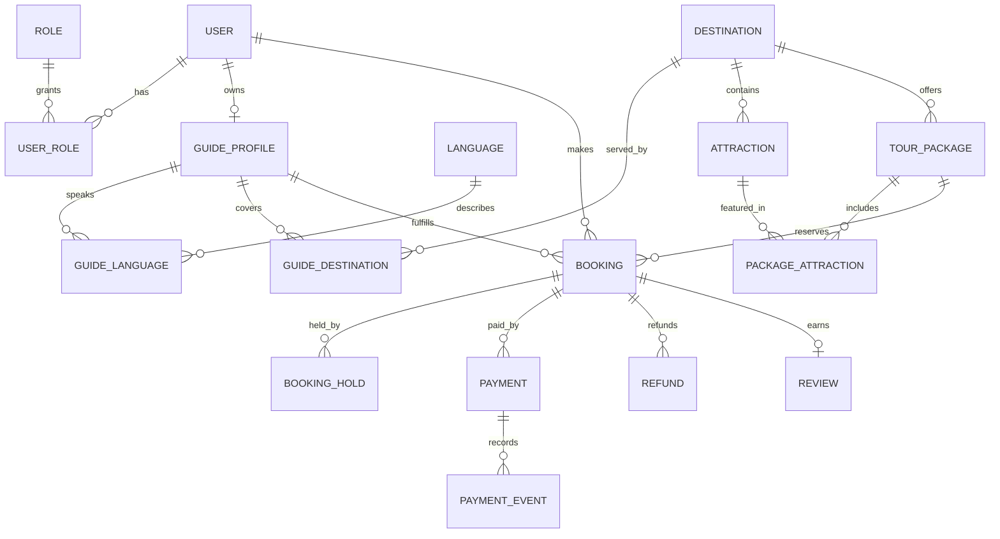

# GuideMyTrip database

GuideMyTrip uses PostgreSQL 16 with Prisma as the typed schema and migration interface. The schema is a normalized modular-monolith design. UUIDs identify domain records; human-facing booking references are separate, stable `GTM-*`/cuid-style values.

## Entities and relationships

- `User`, `Role`, and `UserRole` support tourists, guides, and admins with server-side role assignment.
- `UserAuthProvider`, `OtpVerification`, and `Session` keep authentication data separate from the user profile.
- `GuideProfile` connects to `Language` and `Destination` through `GuideLanguage` and `GuideDestination`; `GuideAvailability` stores date windows and block state.
- `Destination` owns `Attraction` records. `TourPackage` connects destinations to attractions, ordered images, inclusions, exclusions, and a `CancellationPolicy`.
- `Booking` links tourist, guide, package, and destination. It stores money values and immutable `priceSnapshot`/`packageSnapshot` JSONB so later catalog edits cannot rewrite booking history.
- `BookingLanguage`, `BookingGuest`, and `BookingHold` model booking preferences, guest details, and temporary reservation state without comma-separated fields. `BookingLanguage.sortOrder` preserves the tourist's ordered language preferences, and every hold is bound to its selected package.
- `Payment`, `PaymentEvent`, `Refund`, and `BookingCancellation` keep financial and cancellation histories separate from booking state.
- `Review` has a unique `bookingId`, so one completed booking can have one review unless an explicit update policy is added later.
- Reviews have a moderation status and optional moderator audit fields; administrators can approve/reject a review without altering its rating.
- `Notification`, `ContactMessage`, and `AuditLog` provide operational communication and traceability. Notifications carry a typed event, delivery attempts, provider ID, and last error for retry handling.
- Contact messages have workflow status, admin notes, and handler tracking for the operations dashboard.

## Constraints and indexes

Foreign keys use restrictive deletes for financial/history records and cascades only for owned child records. Soft deletion is available on `User`, `GuideProfile`, `Destination`, and `TourPackage` through `deletedAt`; catalog queries must filter inactive/deleted records.

The initial migration enables `btree_gist` and adds PostgreSQL exclusion constraints:

```sql
EXCLUDE USING gist ("guideId" WITH =, daterange("startDate", "endDate", '[)') WITH &&)
WHERE ("bookingStatus" IN ('CONFIRMED', 'COMPLETED'))
```

This prevents overlapping confirmed/completed guide bookings at the database boundary. A matching constraint protects unreleased holds. Dates are half-open: a booking ending on 2026-12-03 does not conflict with one starting on 2026-12-03.

The API booking service must still use a transaction and `pg_advisory_xact_lock` keyed by guide/date while it validates guide availability, capacity, active holds, and inserts the booking. A worker must mark expired holds as released before new holds are created. Constraint violations are returned as a conflict, never retried as a blind insert.

The Phase 5 migration adds ordered booking language preferences and binds holds to packages. Existing installations with legacy, unassociated holds must backfill or expire those holds before applying the non-null package relationship; the migration deliberately does not guess or delete them.

## Migration and seed

```bash
cp .env.example .env
docker compose up -d postgres redis
npm install
npm --workspace @guidemytrip/api run prisma:generate
npm --workspace @guidemytrip/api run prisma:migrate
npm --workspace @guidemytrip/api run prisma:seed
```

`prisma:migrate` runs checked-in migrations without resetting a database. Never use `prisma migrate reset` against a shared or production database without explicit authorization. The first migration is `apps/api/prisma/migrations/20261124120000_initial/migration.sql`.

The seed reads the existing `config/destinations.json` file and upserts database destinations, attractions, roles, languages, packages, guides, and clearly labeled demo users/bookings/reviews. Demo users have no password or usable credential; authentication is intentionally not part of this phase.

## JSON configuration migration path

Phase 2 uses `config/destinations.json` for the public design demo. Phase 3 treats that file as seed input only: the seed upserts by `slug`, preserves database IDs, and copies image/description/highlight data into `Destination` and `Attraction`. Future catalog/admin APIs should read PostgreSQL, add moderation/audit fields, and remove the frontend's direct JSON dependency after a one-time data parity check.

## ER diagram


